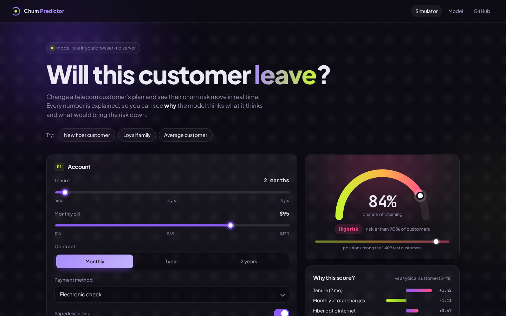
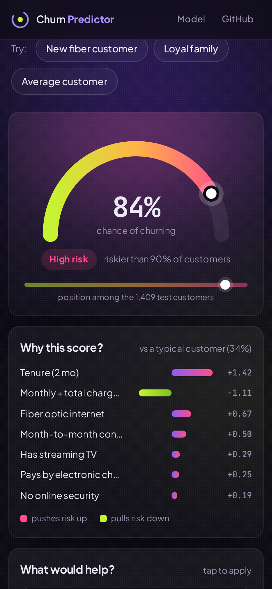
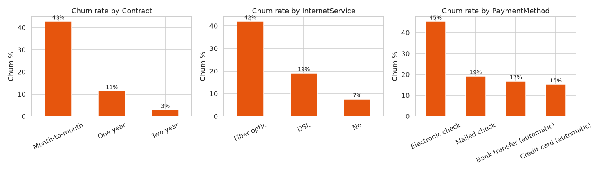

# Customer Churn Prediction

End-to-end machine learning project: explore telecom customer data, find out why customers leave,
train a model that predicts churn, and serve it through a Flask API and a web demo.

**Live demo:** https://tejdeep-churn-predictor.netlify.app



## Problem

A telecom company loses about 1 in 4 customers. Getting a new customer costs more than keeping an old one,
so the retention team wants a list of customers who are likely to leave, plus the reason, so they can
call them with the right offer before they go.

## Dataset

[IBM Telco Customer Churn](https://github.com/IBM/telco-customer-churn-on-icp4d) (Apache 2.0):
7,043 customers, 21 columns: contract, tenure, services, charges, payment method, demographics and
whether they churned. The CSV is in `data/`.

## Approach

1. **Cleaning:** `TotalCharges` was stored as text with 11 blanks. All 11 had tenure 0 (not billed yet), so I filled them with 0.
2. **EDA** ([notebook](notebooks/churn_analysis.ipynb)): churn rate by contract, internet type, payment method, tenure, add-on services.
3. **Modelling:** one-hot encoding + scaling in a scikit-learn `Pipeline`, 80/20 stratified split, 5-fold cross validation.
   Compared Logistic Regression, Logistic Regression with balanced class weights, Random Forest and Gradient Boosting.
4. **Model choice:** all four scored about the same AUC (0.84), so I picked balanced logistic regression. It catches far more
   churners than the plain version, it's easy to explain, and it is small enough to run in the browser.
5. **Deployment:**
   - `app.py`: Flask API, `POST /predict` returns the churn probability, risk level and top reasons
   - `docs/`: static web demo, hosted on Netlify. `src/train.py` exports the scaler and coefficients to `model.json`
     and the page does the same calculation in JavaScript. `tests/test_web_model.py` checks that this formula gives
     the same probability as the sklearn pipeline on 300 customers.

## Web demo: what-if simulator

The demo is meant to feel like a small tool a retention team could actually use:

- Change the customer (tenure, bill, contract, internet, add-ons, payment...) and the **risk gauge** moves straight away.
  It also says where the customer sits among the 1,409 test customers ("riskier than 82% of customers").
- **Why this score?** For logistic regression the score is just a sum, so every feature's part of it can be shown.
  Each bar is that feature's contribution minus the average contribution over the training customers, so the bars
  show how this customer differs from a typical one. Monthly and total charges are shown as one bar because they
  are correlated with tenure and pull in opposite directions on their own.
- **What would help?** The page tries a few changes a retention team could offer (longer contract, free online security
  or tech support, automatic payment), re-scores the customer for each one and lists the ones that lower the risk,
  with how many points. Tapping one applies it.
- Three example customers to start from, and a small floating score bar on phones.



## Results

Test set (1,409 customers the model never saw):

| Model | CV ROC-AUC | Test ROC-AUC | Recall | Precision | F1 |
|---|---|---|---|---|---|
| Logistic Regression | 0.846 | 0.842 | 0.559 | 0.657 | 0.604 |
| **Logistic Regression (balanced)** | **0.846** | **0.842** | **0.783** | **0.504** | **0.614** |
| Random Forest | 0.845 | 0.842 | 0.773 | 0.536 | 0.633 |
| Gradient Boosting | 0.844 | 0.839 | 0.524 | 0.664 | 0.586 |

- The chosen model catches **78% of customers who churn**.
- If the retention team only calls the **top 20% riskiest customers**, they reach **about half of all churners (49.7%)**,
  and 66% of the people they call really are churners (vs 26.5% if they called at random).

What drives churn (from the EDA):

| Factor | Churn rate |
|---|---|
| Month-to-month contract vs two-year | 43% vs 3% |
| First 6 months as a customer | 53% |
| Fiber optic internet vs DSL | 42% vs 19% |
| Electronic check vs automatic card payment | 45% vs 15% |
| No online security vs has it | 42% vs 15% |



**Business suggestions:** offer new month-to-month customers a discount to move to a 1-year contract, push automatic
payments, and bundle tech support / online security with fiber plans.

## Project structure

```
customer-churn-prediction/
├── data/Telco-Customer-Churn.csv
├── notebooks/churn_analysis.ipynb   # EDA + model comparison
├── src/train.py                     # trains final model, exports model.json
├── app.py                           # Flask API
├── templates/index.html             # simple form for the Flask app
├── tests/                           # pytest: API tests + browser formula vs sklearn
├── docs/                            # web demo (static, deployed on Netlify)
├── netlify.toml
└── images/
```

## How to run

```bash
git clone https://github.com/Tejdeep-67/customer-churn-prediction.git
cd customer-churn-prediction
pip install -r requirements.txt

python src/train.py      # trains the model -> models/ and docs/model.json
python app.py            # API on http://127.0.0.1:5000
pytest                   # run the tests
```

Example request:

```bash
curl -X POST http://127.0.0.1:5000/predict -H "Content-Type: application/json" -d '{
  "tenure": 2, "MonthlyCharges": 90, "TotalCharges": 180, "gender": "Female", "SeniorCitizen": 0,
  "Partner": "No", "Dependents": "No", "PhoneService": "Yes", "MultipleLines": "No",
  "InternetService": "Fiber optic", "OnlineSecurity": "No", "OnlineBackup": "No",
  "DeviceProtection": "No", "TechSupport": "No", "StreamingTV": "No", "StreamingMovies": "No",
  "Contract": "Month-to-month", "PaperlessBilling": "Yes", "PaymentMethod": "Electronic check"
}'
```

Response:

```json
{"churn_probability": 0.793, "risk": "High", "top_reasons": ["tenure", "InternetService_Fiber optic", "Contract_Month-to-month"]}
```

To view the web demo locally: `cd docs && python -m http.server 8000`. Netlify just publishes the `docs/` folder
(see `netlify.toml`), there is no build step.

## Limitations

- One snapshot of customers, so there is no time dimension (I can't see when someone churned).
- In the web demo, total charges are estimated as tenure x monthly charges.
- Charges are correlated with tenure and services, so their coefficients alone are not reliable explanations.

## License

MIT for the code, see [LICENSE](LICENSE). The Telco customer churn dataset keeps its original licence.
